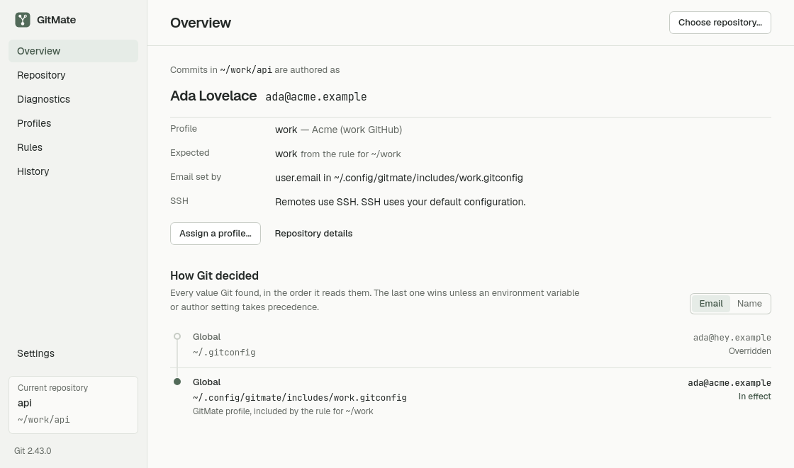
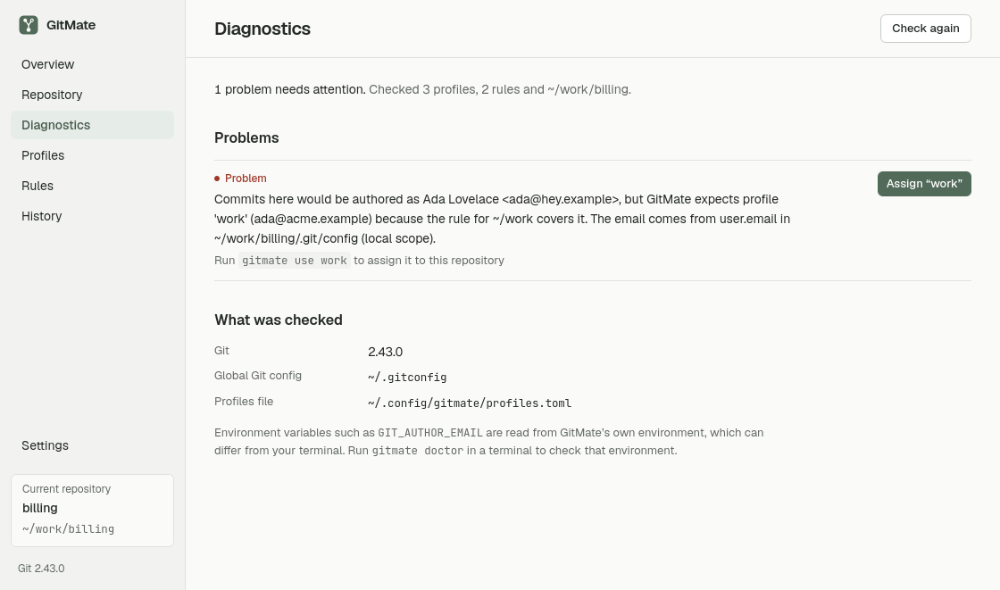
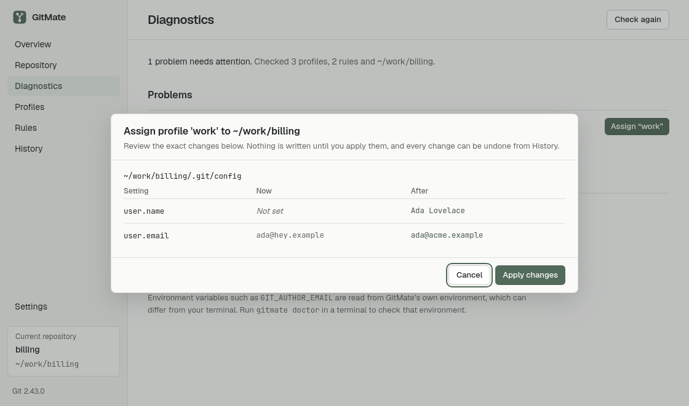
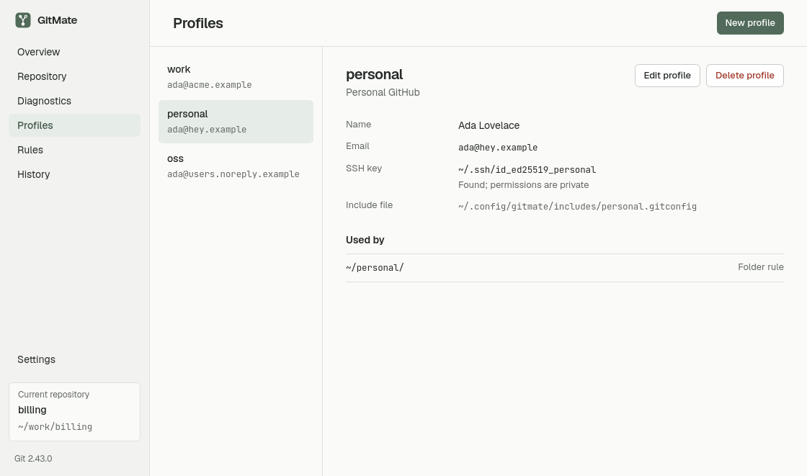
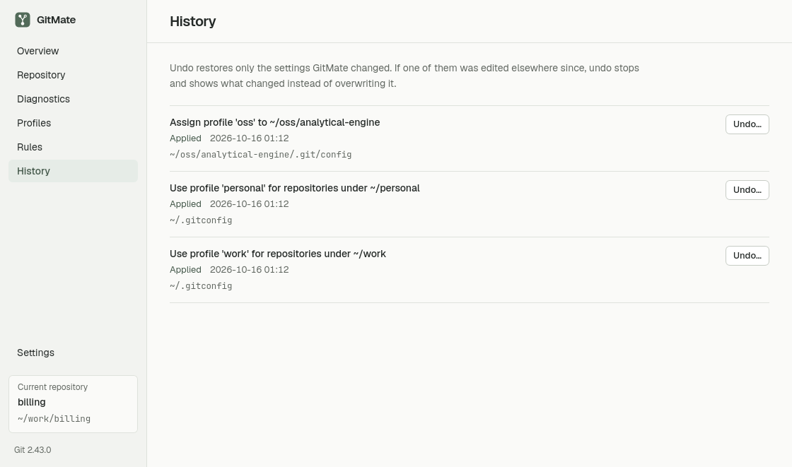

# GitMate

**One machine. Every Git identity. Zero confusion.**

GitMate is a local, open-source Git identity manager for developers who
commit as more than one person: work, personal, open source, clients. It shows
exactly which name and email your next commit will carry and *why*, lets you
assign identities per repository or per folder, previews every configuration
change before writing it, and undoes its own changes safely.

It is a command-line tool and a desktop app built on the same Rust core. No
account, no cloud service, no network access.

> **Status:** v0.1.0, Linux-first. Verified on Pop!_OS 24.04 (Ubuntu 24.04
> base), x86_64, Git 2.43. macOS and Windows are not tested yet.



## Commit identity is not your login

Git keeps four things separate, and so does GitMate:

| | Decided by | GitMate |
| --- | --- | --- |
| **Commit author** (who a commit says wrote it) | `user.name`, `user.email`, `author.*`, `GIT_AUTHOR_*` | Shows where each value comes from; sets them per repository or folder |
| **SSH authentication** (which account can push) | the SSH key ssh offers | Checks the profile's key path; optionally pins it with `core.sshCommand`. Never edits `~/.ssh/config` |
| **HTTPS authentication** | your credential helper | Reports the helper. Does not switch HTTPS accounts and never reads stored tokens |
| **Which setting wins** | Git's config precedence | Asks Git (`git config --show-origin`, `git var`); never guesses |

Changing `user.email` changes what your commits *say*. It does not change which
GitHub or GitLab account your push authenticates as.

## Install

There are no prebuilt downloads yet. Build from source:

```sh
# Requirements: Rust 1.90+ (rustup), Git 2.31+
git clone https://github.com/niadul-munna/gitmate.git && cd gitmate
cargo install --path crates/gitmate-cli   # installs `gitmate` into ~/.cargo/bin
```

The desktop app additionally needs Node.js 24, pnpm 11 and the
[Tauri Linux prerequisites](https://tauri.app/start/prerequisites/):

```sh
sudo apt install libwebkit2gtk-4.1-dev build-essential file libxdo-dev \
  libssl-dev libayatana-appindicator3-dev librsvg2-dev
cd apps/desktop
pnpm install
pnpm tauri build --bundles deb,appimage   # or `pnpm tauri dev` to run it
```

## Getting started (CLI)

Create a profile for each identity:

```sh
gitmate profile add work --name "Ada Lovelace" --email ada@acme.example \
  --label "Acme (work GitHub)" --ssh-key ~/.ssh/id_ed25519_acme
gitmate profile add personal --name "Ada Lovelace" --email ada@home.example
```

See what Git will use in a repository, and why:

```console
$ cd ~/work/api
$ gitmate whoami
Repository   ~/work/api
Author       Ada Lovelace <ada@home.example>
Email from   user.email in ~/.gitconfig (global)
Profile      personal
SSH          default ssh configuration
Remote       origin  ssh  git@github.com:acme/api.git
```

Use a profile for every repository under a folder. This adds an `includeIf`
rule to your global Git config, after showing you the exact change:

```console
$ gitmate rules add ~/work work
Use profile 'work' for repositories under ~/work

  ~/.gitconfig
    [includeIf "gitdir:/home/ada/work/"] path (add)
      - (unset)
      + /home/ada/.config/gitmate/includes/work.gitconfig

Apply these changes? [y/N] y

Done. Recorded as 20261015T110332Z-85e23c (undo with `gitmate undo 20261015T110332Z-85e23c`).
```

Or assign a profile to one repository (writes its `.git/config`; add `--ssh`
to also pin the profile's SSH key for this repository):

```sh
gitmate use work
gitmate use work --ssh
```

Sign commits with the profile's key. The profile's folder rules then set
`user.signingKey`, `gpg.format` and `commit.gpgsign`, and `use --sign` sets
them for one repository:

```sh
gitmate profile edit work --signing-key ~/.ssh/id_ed25519_acme.pub --gpg-format ssh --sign-commits
gitmate use work --sign
```

Tell GitMate which remotes belong to a profile. `whoami` and `doctor` then
warn when a repository's remote says *work* but its commits say *personal*:

```sh
gitmate profile edit work --remote-pattern github.com:acme/
```

Show the active profile in your shell prompt:

```sh
PS1='$(gitmate prompt --format "[{profile}] ")'"$PS1"   # bash; silent outside repositories
```

Find problems, such as a repository whose identity does not match the profile
you expect:

```console
$ gitmate doctor
Git          2.43.0
Profiles     2  (~/.config/gitmate/profiles.toml)
Global file  ~/.gitconfig
Rules        1 managed, 0 other
Repository   ~/work/api
Author       Ada Lovelace <wrong@example.com>

error    Commits here would be authored as Ada Lovelace <wrong@example.com>, but GitMate expects profile 'work' (ada@acme.example) because the rule for ~/work covers it. The email comes from user.email in ~/work/api/.git/config (local scope).  [profile_mismatch]
         hint: Run `gitmate use work` to assign it to this repository
```

`doctor` exits with status 1 when it finds an error, so it can run in scripts.

Review and reverse changes:

```sh
gitmate history
gitmate undo              # most recent change
gitmate undo <operation>  # a specific one
```

### Command reference

| Command | Purpose |
| --- | --- |
| `profile add <id> --name --email [--label] [--ssh-key] [--signing-key] [--gpg-format] [--sign-commits] [--remote-pattern]` | Create a profile |
| `profile list` / `profile show <id>` | List profiles / show one with its rules and repositories |
| `profile edit <id> [--name] [--email] [--label\|--clear-label] [--ssh-key\|--clear-ssh-key] [--signing-key\|--clear-signing-key] [--gpg-format\|--clear-gpg-format] [--sign-commits\|--no-sign-commits] [--remote-pattern\|--clear-remote-patterns]` | Change a profile; folder rules pick up the change |
| `profile remove <id>` | Delete a profile (refused while a rule uses it) |
| `whoami [path] [--short]` | Effective identity, its source, matching profile, SSH and remotes |
| `prompt [path] [--format] [--fallback]` | One line for a shell prompt; `--format` takes `{profile}`, `{name}`, `{email}` |
| `use <profile> [--repo path] [--ssh] [--sign]` | Assign a profile to a repository |
| `rules add <dir> <profile>` / `rules list` / `rules remove <dir>` | Folder rules (`includeIf "gitdir:…"`) |
| `doctor [path] [--ssh-config]` | Diagnostics. `--ssh-config` also runs `ssh -G` for SSH remotes (local only, never connects) |
| `history` / `undo [operation]` | Changes GitMate made, and safe reversal |

Read commands accept `--json`. Commands that write accept `--dry-run` (show the
plan, write nothing) and `--yes` (apply without asking, for scripts). Without a
terminal and without `--yes`, GitMate refuses to change anything that needs
confirmation: replacing or removing existing values, or editing your global
config.

## Desktop app

The desktop app shows the same information visually. These screenshots are
from the real app, run against a demo home directory.

* **Overview**: the identity your next commit will carry in the chosen
  repository, the matching profile, and *How Git decided*, which lists every
  value Git found in the order it reads them and marks the one in effect.
* **Repository**: locations, configuration sources, remotes and how pushes
  authenticate.
* **Diagnostics**: mismatches and configuration problems, with one-click fixes
  that open a change preview.
* **Profiles**, **Rules**, **History** (with undo) and **Settings**.

| Diagnostics | Change preview |
| --- | --- |
|  |  |
| **Profiles** | **History** |
|  |  |

Every change to Git configuration opens a preview of the affected files,
current values, proposed values and conflicts before anything is written.
Profile edits are saved directly; repositories covered by that profile's
folder rules pick up the new name, email or key right away, and the edit form
says so.

## How it stays safe

* **Git decides.** Effective values come from `git var` and `git config
  --show-origin`. GitMate has no config parser.
* **Targeted writes.** Changes are `git config --file <exact file>` calls on
  one key at a time. Adding or removing one value leaves the key's other values
  where they are. Comments, formatting and unrelated settings are untouched.
* **Preview, then apply.** At apply time every key is re-read, and again just
  before the first write; if anything changed since the preview, nothing is
  written.
* **Recoverable.** Every applied change is journaled, affected files are backed
  up (`0600`), a failed write reverts what it already changed, and `undo`
  restores only GitMate's keys, refusing if someone edited them since or if
  a later operation changed the same key (undo that one first).
* **Narrow desktop surface.** The webview can call only GitMate's own
  commands and the native file picker, behind a strict CSP.

Details: [SECURITY.md](SECURITY.md), [docs/architecture.md](docs/architecture.md),
[docs/git-behavior.md](docs/git-behavior.md).

## Files

| Path (Linux) | Content |
| --- | --- |
| `~/.config/gitmate/profiles.toml` | Profiles ([example](examples/profiles.toml)) |
| `~/.config/gitmate/includes/<id>.gitconfig` | Generated per-profile include files |
| `~/.local/state/gitmate/` | Operation history, backups, lock |

`XDG_CONFIG_HOME` / `XDG_STATE_HOME` are respected. `GITMATE_CONFIG_DIR` and
`GITMATE_STATE_DIR` override the locations. See [examples/](examples/) for
exactly what GitMate writes into Git config files.

## Known limitations

* Linux only is verified. macOS and Windows code paths exist but are untested.
* Remote patterns only inform `whoami` and `doctor`; they never change Git
  configuration by themselves.
* The desktop app does not show or edit signing settings or remote patterns
  yet. Editing a profile there keeps them.
* Rules are `gitdir:` rules only; `onbranch:` and `hasconfig:` includes are
  listed but not managed.
* New folder rules are written to the global config file Git writes with
  `--global`. Removing a GitMate rule edits whichever global file holds it
  (for example `~/.config/git/config`). Rules GitMate did not write are
  shown but never edited.
* Rules inside files pulled in with `[include]` are not listed or checked for
  conflicts.
* The desktop app sees its own environment variables, which can differ from
  your terminal's. Run `gitmate whoami` in the terminal to check those.
* Undo is per key. A restored `includeIf` entry goes after any other entry
  for the same directory, or at the end of the file if there is none. Git
  treats that the same unless other settings depend on the order.

## Development

See [CONTRIBUTING.md](CONTRIBUTING.md). In short:

```sh
cargo test                                   # core + CLI against temporary Git repos
cd apps/desktop && pnpm install && pnpm test # UI tests
```

## License

[MIT](LICENSE). GitMate is a small developer utility meant to be easy to
adopt, package and embed. MIT is the shortest widely understood permissive
license and is compatible with the licenses of its dependencies. Apache-2.0's
explicit patent grant was considered, but there is no patent-sensitive
technology here to justify its extra length and NOTICE requirements.
